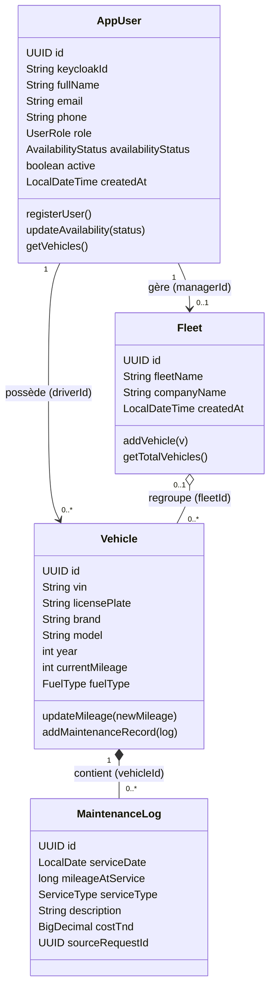

# MS1 – Auth, Fleet & Vehicle Service

Projet **Mecanico** – Module AWD – Validation 1

## 1. Responsabilités
- Inscription, authentification et rôles (RBAC) via Keycloak (JWT).
- Gestion des véhicules et des flottes d'entreprise.
- Disponibilité des prestataires (AVAILABLE, BUSY, OFFLINE).
- Carnet d'entretien alimenté par les interventions facturées.
- Ne gère pas : demandes, tarifs, paiements, avis (autres microservices).

## 2. Entités et modèle de données
| Entité | Rôle | Attributs principaux |
|---|---|---|
| AppUser | Utilisateur (DRIVER, PROVIDER, FLEET_MANAGER, ADMIN) | id, keycloakId (unique), fullName, email (unique), phone, role, availabilityStatus, active, createdAt |
| Fleet | Flotte d'entreprise | id, fleetName, companyName, createdAt, managerId |
| Vehicle | Véhicule d'un conducteur | id, vin (unique), licensePlate (unique), brand, model, year, currentMileage, fuelType, driverId, fleetId (nullable) |
| MaintenanceLog | Historique d'entretien | id, serviceDate, mileageAtService, serviceType, description, costTnd, sourceRequestId (unique), vehicleId |

Énumérations : `UserRole` (DRIVER, PROVIDER, FLEET_MANAGER, ADMIN), `AvailabilityStatus` (AVAILABLE, BUSY, OFFLINE), `FuelType` (PETROL, DIESEL, HYBRID, ELECTRIC), `ServiceType` (OIL_CHANGE, BRAKES, BATTERY, TIRES, ENGINE, TOWING).

Relations :
- AppUser 1 — 0..* Vehicle (driverId)
- AppUser 1 — 0..1 Fleet (managerId)
- Fleet 0..1 — 0..* Vehicle (fleetId)
- Vehicle 1 — 0..* MaintenanceLog (vehicleId)

### Diagramme de classes

## 3. Base de données : MySQL (`mecanico_user_fleet_db`)
Tables : `app_user`, `fleet`, `vehicle`, `maintenance_log`.

| Table | Clés et contraintes |
|---|---|
| app_user | PK id, UNIQUE keycloak_id, UNIQUE email |
| fleet | PK id, FK manager_id → app_user |
| vehicle | PK id, UNIQUE vin, UNIQUE license_plate, FK driver_id → app_user, FK fleet_id → fleet (nullable) |
| maintenance_log | PK id, FK vehicle_id → vehicle, UNIQUE source_request_id, cost_tnd DECIMAL(10,2) |

**Pourquoi MySQL ?**
- Données fortement relationnelles (utilisateur → véhicule → entretien) avec clés étrangères.
- Transactions ACID (InnoDB) : ajout de véhicule et mise à jour du kilométrage cohérents.
- Contraintes d'unicité natives, utilisées aussi pour l'idempotence (`source_request_id`).
- DECIMAL pour les montants (pas d'erreur d'arrondi) ; index sur driver_id et vehicle_id.
- Une base par microservice : aucun autre service ne lit ou n'écrit dans cette base.

## 4. API REST (via API Gateway, JWT Keycloak)
| Méthode | URI | Rôle | Succès | Erreurs |
|---|---|---|---|---|
| POST | /users/register | public | 201 | 400, 409 (email déjà utilisé) |
| GET | /users/me | tous | 200 | 401, 404 |
| PUT | /users/me/availability | PROVIDER | 200 | 400, 401, 403 |
| GET | /vehicles | DRIVER | 200 | 401 |
| POST | /vehicles | DRIVER | 201 | 400, 401, 409 (VIN ou plaque existants) |
| GET | /vehicles/{id} | DRIVER, FLEET_MANAGER | 200 | 401, 403, 404 |
| PUT | /vehicles/{id}/mileage | DRIVER | 200 | 400 (kilométrage inférieur), 403, 404 |
| GET | /vehicles/{id}/maintenance-logs | DRIVER, FLEET_MANAGER | 200 | 401, 403, 404 |
| POST | /fleets | FLEET_MANAGER | 201 | 400, 403 |
| GET | /fleets/{id} | FLEET_MANAGER | 200 | 403, 404 |
| POST | /fleets/{id}/vehicles | FLEET_MANAGER | 200 | 403, 404, 409 |

## 5. Interactions avec les autres services
| Service | Sens | Mode | Données |
|---|---|---|---|
| Keycloak | MS1 valide les JWT | synchrone (clés publiques JWKS) | identité, rôle, userId |
| API Gateway / Eureka | la gateway route vers MS1 ; MS1 s'enregistre | synchrone | – |
| Matching | MS1 publie | asynchrone (événement) | ProviderAvailabilityChanged {providerUserId, status} |
| Billing | MS1 consomme | asynchrone (événement) | InvoiceGenerated {requestId, vehicleId, serviceType, totalTnd, completedAt} → crée un MaintenanceLog |
| Request, Provider, Review, AI | aucun appel direct | – | lisent userId et rôle dans le JWT ; le client envoie vehicleId dans POST /requests |

**Pourquoi asynchrone ?** MS1 ne doit dépendre d'aucun autre service pour fonctionner, et inversement. Les échanges passent par un broker ; chaque service garde une copie locale des données dont il a besoin.

### Comportement en cas de panne
- **Billing indisponible** : aucun InvoiceGenerated reçu, MS1 continue de fonctionner ; l'événement est livré et traité au retour du service (doublon ignoré grâce à `source_request_id`).
- **Broker indisponible** : la disponibilité reste enregistrée en base ; la publication est retentée.
- **Keycloak indisponible** : les JWT déjà émis restent valides jusqu'à expiration (clés en cache) ; les nouvelles connexions échouent.
- **Eureka indisponible** : les services utilisent leur registre en cache.
- **MySQL indisponible** : MS1 répond 503, les autres services ne sont pas affectés.
