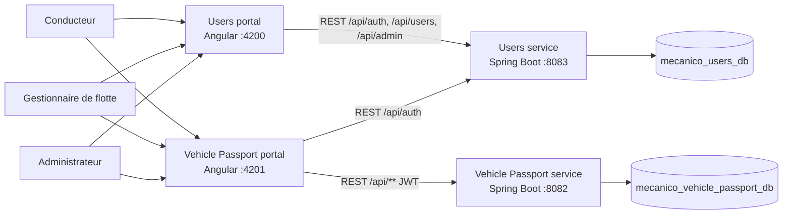
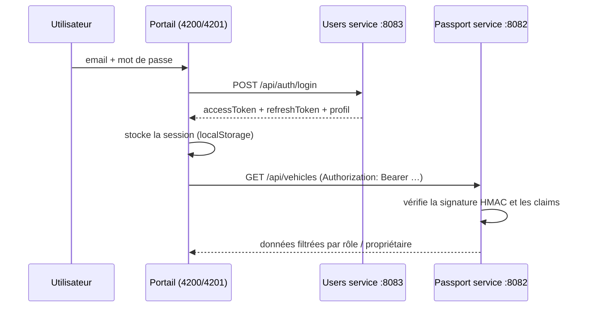

# Architecture Mecanico — MS1 Vehicle Passport

> Module AWD — Architecture Web Distribuée — 2026-2027

## 1. Vue d'ensemble

Mecanico est décomposé en deux services déployables indépendamment :

| Composant | Technologie | Port | Base de données |
|---|---|---|---|
| **Users service** (`Mecanico-Users`) | Spring Boot 3.5 / Java 21 | **8083** | `mecanico_users_db` |
| **Users portal** (`Mecanico-Users/Frontend`) | Angular 21 | **4200** | — |
| **Vehicle Passport service** (ce dépôt) | Spring Boot 3.5 / Java 21 | **8082** | `mecanico_vehicle_passport_db` |
| **Vehicle Passport portal** (`Frontend`) | Angular 21 | **4201** | — |
| MySQL | WAMP / MySQL 8+ | 3306 | 2 schémas |

## 2. Flux d'authentification (JWT partagé)

Il n'y a pas encore de Keycloak ni d'API Gateway : le Users service joue le rôle de fournisseur
d'identité et émet lui-même les JWT HS256.

- Algorithme : **HS256**, secret partagé par variable d'environnement `JWT_SECRET`.
- Claims utilisés : `sub` / `uid`, `email`, `role`, `name`.
- Le portail Vehicle Passport se connecte au Users service (`environment.usersApiBaseUrl`),
  puis envoie le **même** jeton au service Passport.
- Les deux services refusent une requête sans jeton valide (401) ou avec un rôle insuffisant (403).

## 3. Modèle de données MS1

Diagramme de classes : `Documentation/Diagrams/ms1-class-diagram.mmd`.

| Table | Rôle |
|---|---|
| `vehicle_brand` | Catalogue des marques (Toyota, Volkswagen, Renault, Peugeot, Hyundai, …) |
| `vehicle_model` | Modèles par marque + type de carrosserie (`body_type`) |
| `vehicle` | Passeport du véhicule : identité, caractéristiques techniques, propriétaire, kilométrage |
| `maintenance_record` | Interventions : type, date, kilométrage, coûts main-d'œuvre/pièces, prochaine échéance |
| `vehicle_document` | Documents administratifs : assurance, visite technique, vignette, carte grise |
| `service_reminder` | Rappels par kilométrage ou par date, avec statut et suivi de notification |
| `notification_log` | Journal des notifications in-app générées par le scan quotidien |

Le catalogue est partagé par les deux portails via `GET /api/catalog/**` (public).
Chaque véhicule référence une marque et un modèle actifs ; la création vérifie que le modèle
appartient bien à la marque choisie.

## 4. Règles d'accès

| Rôle | Portée |
|---|---|
| `DRIVER` | Voit et modifie uniquement les véhicules dont `owner_id` = son identifiant |
| `FLEET_MANAGER` | Voit tous les véhicules, peut réassigner un véhicule à un conducteur |
| `ADMIN` | Identique au gestionnaire + peut lancer le scan des échéances (`POST /api/admin/scan`) |
| `PROVIDER` | Authentifié mais ne possède pas de véhicule par défaut ; accès selon propriété |

Règles complémentaires :

- Un conducteur ne peut pas créer un véhicule pour un autre propriétaire (`ownerId` interdit).
- Un gestionnaire ou administrateur peut créer/modifier `ownerId`.
- La suppression d'un véhicule supprime en cascade ses enregistrements, documents, rappels et notifications.
- Le kilométrage ne peut jamais diminuer (`PATCH /api/vehicles/{id}/mileage`).

## 5. API du service Passport (`http://localhost:8082`)

### Catalogue public

| Méthode | Chemin | Description |
|---|---|---|
| GET | `/api/catalog` | Marques + modèles actifs en une requête |
| GET | `/api/catalog/brands` | Liste des marques |
| GET | `/api/catalog/brands/{brandId}/models` | Modèles d'une marque |
| GET | `/api/catalog/models?brandId=…&search=…` | Recherche de modèles |

### Véhicules (JWT requis)

| Méthode | Chemin | Description |
|---|---|---|
| POST | `/api/vehicles` | Créer un véhicule + 2 rappels par défaut (huile, pneus) |
| GET | `/api/vehicles?search=&status=&ownerId=&page=&size=` | Liste paginée filtrée par rôle |
| GET | `/api/vehicles/{id}` | Détail d'un véhicule |
| PUT | `/api/vehicles/{id}` | Modifier le véhicule |
| DELETE | `/api/vehicles/{id}` | Supprimer le véhicule et ses données liées |
| PATCH | `/api/vehicles/{id}/mileage` | Mettre à jour le kilométrage (croissant) |
| GET | `/api/vehicles/{id}/passport` | Vue agrégée : véhicule + carnet + documents + rappels + santé + stats |
| GET | `/api/vehicles/{id}/health` | Score de santé détaillé |

### Carnet d'entretien

| Méthode | Chemin |
|---|---|
| GET | `/api/vehicles/{vehicleId}/records` |
| POST | `/api/vehicles/{vehicleId}/records` |
| DELETE | `/api/vehicles/{vehicleId}/records/{recordId}` |

Un enregistrement de type `SERVICE` clôt le rappel de vidange ouvert et programme le suivant
10 000 km plus loin. Le kilométrage du véhicule est aligné si l'intervention est plus récente.

### Documents

| Méthode | Chemin |
|---|---|
| GET | `/api/vehicles/{vehicleId}/documents` |
| GET | `/api/vehicles/{vehicleId}/documents/expiring?days=30` |
| POST | `/api/vehicles/{vehicleId}/documents` |
| PUT | `/api/vehicles/{vehicleId}/documents/{documentId}` |
| DELETE | `/api/vehicles/{vehicleId}/documents/{documentId}` |

### Rappels

| Méthode | Chemin |
|---|---|
| GET | `/api/vehicles/{vehicleId}/reminders` |
| POST | `/api/vehicles/{vehicleId}/reminders` |
| PATCH | `/api/vehicles/{vehicleId}/reminders/{reminderId}/status` |
| DELETE | `/api/vehicles/{vehicleId}/reminders/{reminderId}` |

### Tableau de bord et notifications

| Méthode | Chemin | Rôle |
|---|---|---|
| GET | `/api/dashboard/summary` | Tous — KPIs, véhicules, alertes |
| GET | `/api/notifications` | Tous — journal in-app filtré par accès |
| POST | `/api/admin/scan` | `ADMIN` — scan manuel des échéances |
| GET | `/api/me/vehicle-ids` | Tous — identifiants visibles (intégration interne) |

Documentation interactive : `http://localhost:8082/swagger-ui.html`.

## 6. Score de santé déterministe

Le score part de **100 points** et retire des pénalités. Aucun modèle d'IA n'est utilisé.

| Dimension | Pénalité maximale | Règle |
|---|---|---|
| Âge | 20 | `(années - 4) × 2`, plafonné à 20 |
| Kilométrage | 20 | `(km ÷ 20 000) × 2`, plafonné à 20 |
| Entretien | 25 | 15 si aucun enregistrement ; +10 si dernier entretien > 12 mois ; +10 si > 15 000 km depuis |
| Documents | 21 | 5 par document expiré, 2 par document expirant sous 30 jours |
| Rappels | 15 | 5 par rappel en retard, 2 par rappel dû |

Grades : `EXCELLENT ≥ 85`, `GOOD ≥ 70`, `FAIR ≥ 50`, sinon `POOR`.

La réponse `/health` contient `score`, `grade`, `summary`, `breakdown` (points retirés par dimension)
et `factors[]` (explication lisible de chaque règle).

## 7. Scan quotidien des documents et rappels

- Cron par défaut : **08:00** (`0 0 8 * * *`, fuseau `Africa/Tunis`), configurable via `DOCUMENT_SCAN_CRON`.
- Documents actifs : notification à **J-30** puis **J-7** avant expiration (champs `notification30Sent`, `notification7Sent`).
- Rappels kilométriques : statut effectif recalculé selon le kilométrage (`PENDING → DUE → OVERDUE`).
- Rappels datés : `DUE` dans les 30 jours, `OVERDUE` après la date.
- Les notifications sont écrites dans `notification_log` et exposées par `GET /api/notifications`.
- L'administrateur peut déclencher le scan à la demande depuis le tableau de bord.

## 8. Configuration

Variables d'environnement principales du service Passport :

| Variable | Défaut | Rôle |
|---|---|---|
| `DB_USER` / `DB_PASSWORD` | `mecanico` / `mecanico` | Connexion MySQL |
| `JWT_SECRET` | secret de développement partagé | Validation des jetons du Users service |
| `CORS_ORIGINS` | `http://localhost:4200,4201` | Origines autorisées |
| `SCHEDULER_ENABLED` | `true` | Active le scan quotidien |
| `DOCUMENT_SCAN_CRON` | `0 0 8 * * *` | Expression cron du scan |
| `SEED_DEMO_DATA` | `true` | Jeu de données de démonstration au démarrage |

## 9. Scénarios vérifiés

- Connexion via le Users service puis appels au service Passport avec le même JWT.
- Conducteur : 2 véhicules visibles, accès refusé (403) au véhicule d'un autre conducteur.
- Gestionnaire et administrateur : 5 véhicules visibles, réassignation possible.
- Création d'un véhicule avec cascade marque → modèle et génération de 2 rappels.
- CRUD véhicule, mise à jour du kilométrage, ajout/suppression d'un enregistrement et d'un document.
- Ajout, complétion, rejet et suppression d'un rappel.
- Score de santé, onglets du passeport, notifications et scan administrateur.
