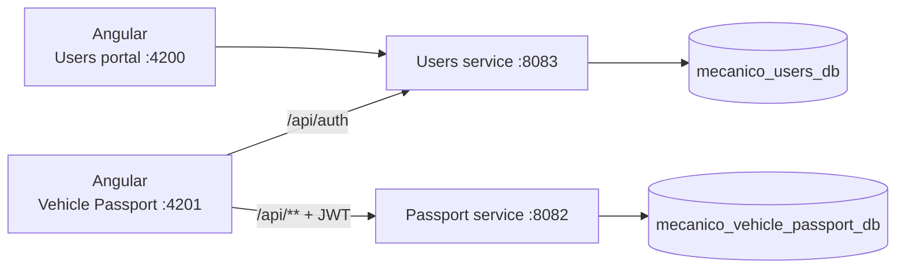

# Mecanico — MS1 Vehicle Passport

Microservice **Vehicle Passport** de la plateforme Mecanico : un carnet de bord numérique par
véhicule (entretien, documents administratifs, kilométrage, rappels) avec un score de santé
déterministe, accompagné d'un portail Angular.

> Module AWD — Architecture Web Distribuée — 2026-2027

Le service **Users** (authentification, profils, rôles, adresses, administration) vit dans le
dépôt voisin `../Mecanico-Users`.

## Sommaire

- [Architecture](#architecture)
- [Fonctionnalités](#fonctionnalités)
- [Stack technique](#stack-technique)
- [Structure du dépôt](#structure-du-dépôt)
- [Bases de données](#bases-de-données)
- [Lancement](#lancement)
- [Comptes de démonstration](#comptes-de-démonstration)
- [Règles métier](#règles-métier)
- [Documentation](#documentation)

## Architecture



- Le portail Passport s'authentifie auprès du **Users service** (8083) et réutilise le même JWT
  pour appeler le service Passport (8082).
- Les deux services partagent le même secret HMAC (`JWT_SECRET`) ; MS1 valide les jetons sans
  appeler le Users service à chaque requête.
- Keycloak, Eureka, Config Server et l'API Gateway ne sont pas encore déployés : l'architecture
  actuelle les remplace par un JWT auto-émis et des URLs directes, mais les services sont prêts
  à être placés derrière une gateway.

## Fonctionnalités

- **Passeport véhicule** : identité, VIN, plaque, marque/modèle du catalogue, caractéristiques
  techniques, propriétaire, photo, notes, statut.
- **Carnet d'entretien** : services, réparations, inspections, pièces changées, coûts
  main-d'œuvre/pièces, prochaines échéances.
- **Documents administratifs** : assurance, visite technique, vignette, carte grise, avec
  alertes à J-30 et J-7.
- **Rappels de service** : vidange, rotation des pneus, freins, batterie, visite technique,
  assurance, rappels personnalisés ; statuts `PENDING`, `DUE`, `OVERDUE`, `COMPLETED`, `DISMISSED`.
- **Score de santé 0–100** expliqué par des facteurs (âge, kilométrage, entretien, documents,
  rappels) — règles déterministes, sans IA.
- **Tableau de bord** adapté au rôle : KPIs, véhicules, alertes, dépenses d'entretien.
- **Notifications in-app** : journal généré par le scan quotidien ou par l'administrateur.
- **Catalogue marques/modèles** : 20 marques et leurs modèles, cascade marque → modèle dans le
  formulaire véhicule.
- **Contrôle d'accès** : un conducteur ne voit que ses véhicules ; gestionnaire de flotte et
  administrateur voient tout le parc.

## Stack technique

| Couche | Technologie |
|---|---|
| Backend | Java 21, Spring Boot 3.5, Spring Security, Spring Data JPA, Bean Validation |
| JWT | JJWT 0.12 (HS256), filtre d'authentification partagé avec le Users service |
| Base | MySQL 8+ (WAMP), base par service |
| Documentation API | springdoc-openapi / Swagger UI |
| Frontend | Angular 21 standalone, signals, zoneless, Bootstrap 5, Bootstrap Icons |
| Tests manuels | Swagger, portails Angular, API REST |

## Structure du dépôt

```
Mecanico/
├── Backend/
│   ├── api-gateway/                  # Spring Cloud Gateway (port 8084)
│   ├── eureka-server/                # Registre Eureka (port 8761)
│   ├── marketplace-service/          # Spring Boot MS3 Marketplace (port 8081)
│   └── vehicle-passport-service/     # Spring Boot MS1 (port 8082)
├── Database/
│   └── 02_mecanico_vehicle_passport_db.sql
├── Documentation/
│   ├── architecture.md               # contrat API, modèle, règles, sécurité
│   ├── Diagrams/ms1-class-diagram.mmd
│   └── Presentation/
├── Frontend/                         # Angular Vehicle Passport + MS3 Marketplace/Dépannage (port 4201)
└── README.md
```

Dépôt voisin :

```
Mecanico-Users/
├── Backend/user-service/             # Spring Boot Users (port 8083)
├── Database/01_mecanico_users_db.sql
├── Documentation/architecture.md
└── Frontend/                         # Angular Users portal (port 4200)
```

## Bases de données

Deux schémas MySQL indépendants :

| Base | Script | Service |
|---|---|---|
| `mecanico_users_db` | `Mecanico-Users/Database/01_mecanico_users_db.sql` | Users :8083 |
| `mecanico_vehicle_passport_db` | `Mecanico/Database/02_mecanico_vehicle_passport_db.sql` | Passport :8082 |

### Import avec WAMP

1. Démarrer WAMP et vérifier que MySQL écoute sur `3306`.
2. Importer les scripts via phpMyAdmin **ou** en ligne de commande :

```bash
mysql -u root < "Mecanico-Users/Database/01_mecanico_users_db.sql"
mysql -u root < "Mecanico/Database/02_mecanico_vehicle_passport_db.sql"
```

3. Créer l'utilisateur applicatif utilisé par les deux services :

```sql
CREATE USER IF NOT EXISTS 'mecanico'@'localhost' IDENTIFIED BY 'mecanico';
GRANT ALL PRIVILEGES ON mecanico_users_db.* TO 'mecanico'@'localhost';
GRANT ALL PRIVILEGES ON mecanico_vehicle_passport_db.* TO 'mecanico'@'localhost';
FLUSH PRIVILEGES;
```

Les scripts créent les tables, le catalogue véhicules et un jeu de données de démonstration
(6 utilisateurs, 5 véhicules, entretiens, documents, rappels, notifications).

> Réinitialisation complète du jeu de démonstration : supprimer les deux bases, réimporter les
> scripts, puis redémarrer les services. Mettre `SEED_DEMO_DATA=false` en production.

## Lancement

### Avec Docker (recommandé)

Prérequis : **Docker Desktop** (ou Docker Engine + Compose v2), 8 Go de RAM.

```bash
cp .env.example .env                          # facultatif : mots de passe, ports, mémoire
docker compose --profile all up -d --build    # toute la plateforme
docker compose ps                             # attendre l'état "healthy"
```

| URL | Service |
|---|---|
| http://localhost:4201 | Front-end Angular |
| http://localhost:8084 | API Gateway (point d'entrée unique des API) |
| http://localhost:8761 | Eureka (services enregistrés) |
| http://localhost:8180 | Keycloak (realm `mecanico`, console `admin` / `admin`) |
| http://localhost:15672 | RabbitMQ (`guest` / `guest`) |

Pour ne lancer que l'infrastructure commune (et développer son microservice dans l'IDE) :
`docker compose up -d`. Profils, ajout d'un service et dépannage : voir
[CONTRIBUTING.md § 4](CONTRIBUTING.md#4-infrastructure-docker).

### Sans Docker

Prérequis : **JDK 21+**, **Maven 3.9+**, **Node.js 22+**, **npm 11+**, MySQL (WAMP).

### 1. Users service — port 8083

```bash
cd Mecanico-Users/Backend/user-service
mvn clean package
java -jar target/user-service-0.0.1-SNAPSHOT.jar
```

- Santé : http://localhost:8083/actuator/health
- Swagger : http://localhost:8083/swagger-ui.html

### 2. Passport service — port 8082

```bash
cd Mecanico/Backend/vehicle-passport-service
mvn clean package
java -jar target/vehicle-passport-service-0.0.1-SNAPSHOT.jar
```

- Santé : http://localhost:8082/actuator/health
- Swagger : http://localhost:8082/swagger-ui.html

### 3. Portail Users — port 4200

```bash
cd Mecanico-Users/Frontend
npm install
npm start -- --port 4200
```

### 4. Portail Vehicle Passport — port 4201

```bash
cd Mecanico/Frontend
npm install
npm start -- --port 4201
```

Ouvrir http://localhost:4201. Le portail interroge le Users service sur 8083 puis le service
Passport sur 8082 (voir `src/environments/environment.ts`).

### 5. Marketplace service (MS3) — port 8081

```bash
mysql -u root < "Backend/marketplace-service/scripts/create-database.sql"
cd Backend/marketplace-service
./mvnw spring-boot:run
```

Les tables sont créées par Flyway (`src/main/resources/db/migration`). Variables :
`MARKETPLACE_DB_URL`, `MARKETPLACE_DB_USERNAME`, `MARKETPLACE_DB_PASSWORD`, `SERVER_PORT`,
`CORS_ALLOWED_ORIGINS` (voir `.env.example`). Swagger : http://localhost:8081/swagger-ui.html

Dans le portail, les pages **Marketplace** (`/marketplace`) et **Roadside assistance**
(`/dispatch`, données simulées + carte Leaflet) appellent directement ce service via
`environment.marketplaceApiBaseUrl`. Le service n'est pas encore enregistré dans Eureka ni
routé par l'API Gateway.

### Variables d'environnement utiles

| Variable | Défaut | Service |
|---|---|---|
| `DB_USER` / `DB_PASSWORD` | `mecanico` / `mecanico` | Les deux |
| `JWT_SECRET` | secret de développement | **Identique dans les deux services** |
| `CORS_ORIGINS` | `http://localhost:4200,4201` | Les deux |
| `SCHEDULER_ENABLED` | `true` | Passport |
| `DOCUMENT_SCAN_CRON` | `0 0 8 * * *` | Passport |
| `SEED_DEMO_DATA` | `true` | Les deux |

## Comptes de démonstration

Mot de passe commun : **`Password123!`**

| Email | Rôle | Accès véhicules |
|---|---|---|
| `admin@mecanico.tn` | `ADMIN` | Tous + scan des échéances |
| `fleet@mecanico.tn` | `FLEET_MANAGER` | Tous, réassignation possible |
| `driver@mecanico.tn` | `DRIVER` | Toyota Corolla, Volkswagen Golf |
| `driver2@mecanico.tn` | `DRIVER` | Renault Clio, Peugeot 208, Hyundai Tucson |
| `provider@mecanico.tn` | `PROVIDER` | Aucun véhicule par défaut |
| `pending@mecanico.tn` | `DRIVER` (PENDING) | Connexion refusée tant que le compte n'est pas activé |

## Règles métier

### Accès

- `DRIVER` : lecture/écriture uniquement sur `owner_id = utilisateur`.
- `FLEET_MANAGER` et `ADMIN` : tous les véhicules ; peuvent définir `ownerId` à la création/édition.
- `ADMIN` seul : `POST /api/admin/scan`.
- Le kilométrage ne peut jamais diminuer.

### Score de santé

Score = `100 - pénalités` :

| Dimension | Max | Détail |
|---|---|---|
| Âge | 20 | `(années - 4) × 2` |
| Kilométrage | 20 | `(km ÷ 20 000) × 2` |
| Entretien | 25 | 15 si aucun historique ; +10 si > 12 mois ; +10 si > 15 000 km |
| Documents | 21 | 5 par document expiré, 2 par document expirant sous 30 jours |
| Rappels | 15 | 5 par rappel en retard, 2 par rappel dû |

Grades : `EXCELLENT ≥ 85`, `GOOD ≥ 70`, `FAIR ≥ 50`, `POOR < 50`.

### Automatismes

- Création d'un véhicule → 2 rappels à +10 000 km : vidange et rotation des pneus.
- Enregistrement `SERVICE` → clôt le rappel de vidange et en programme un nouveau à +10 000 km.
- Scan quotidien à 08:00 (`Africa/Tunis`) → notifications documents J-30/J-7 et rappels dus.
- Mise à jour du kilométrage → recalcul des statuts de rappels et du score.

## Documentation

- [`Documentation/architecture.md`](Documentation/architecture.md) — architecture détaillée,
  modèle de données, contrat API complet, règles de sécurité et de calcul.
- [`Documentation/Diagrams/ms1-class-diagram.mmd`](Documentation/Diagrams/ms1-class-diagram.mmd) —
  diagramme de classes Mermaid.
- `Backend/vehicle-passport-service/README.md` — guide du backend.
- `Frontend/README.md` — guide du portail Angular.
- `../Mecanico-Users/README.md` — service Users, comptes, rôles et administration.
