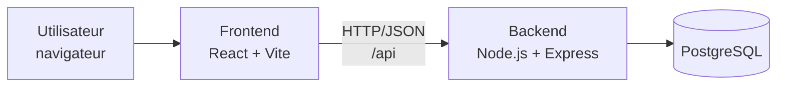
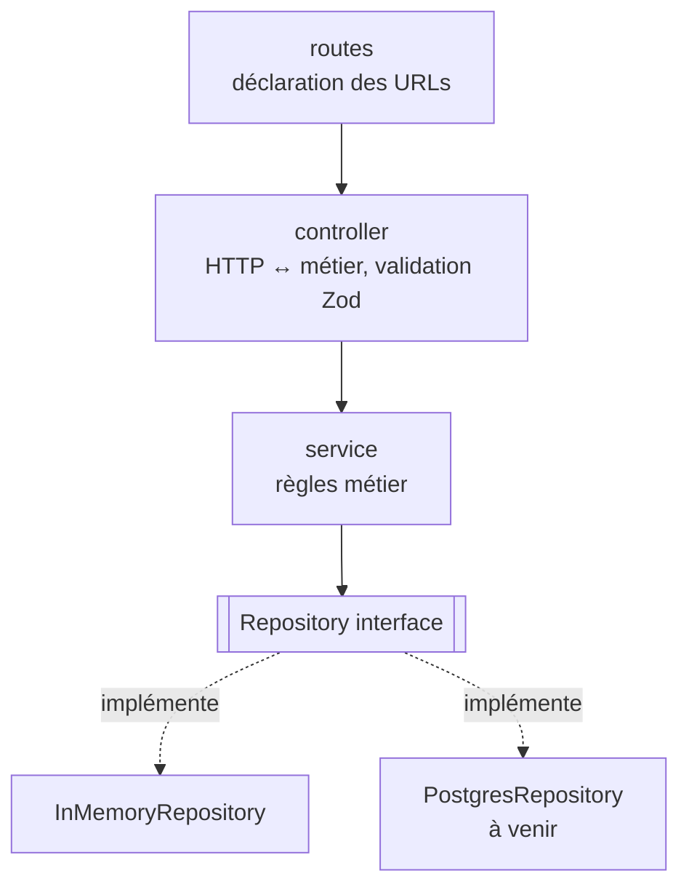
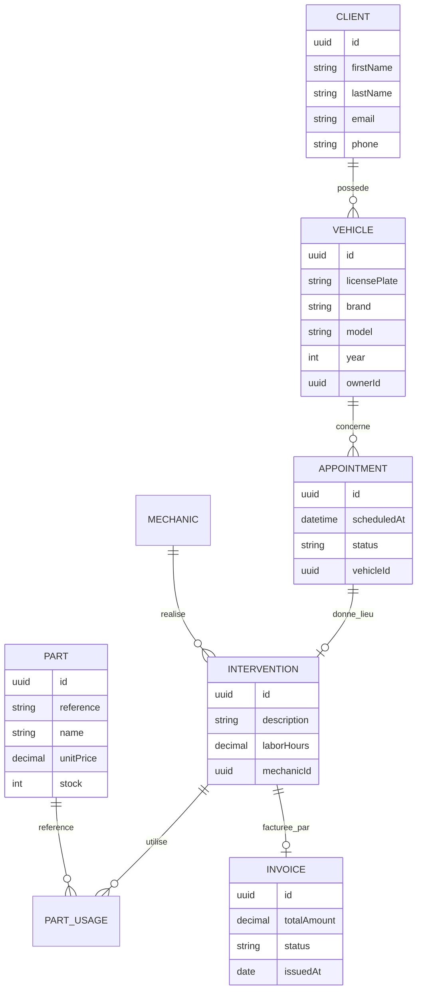

# Architecture du projet Mecanico

> Ticket de référence : [MEC-1 – Create architecture for project](https://dreamyhomeguide-team-v4nzk0m0.atlassian.net/browse/MEC-1)

## 1. Contexte

Mecanico est un projet universitaire. Le ticket MEC-1 ne détaille pas le périmètre fonctionnel ;
l'hypothèse retenue (d'après le nom du projet) est une **application web de gestion d'atelier mécanique** :
clients, véhicules, rendez-vous, interventions et factures.

L'architecture vise à être :

- **simple** à prendre en main par une équipe étudiante ;
- **modulaire**, pour que chaque membre puisse travailler sur un domaine sans conflit ;
- **testable**, la logique métier étant indépendante du framework HTTP et de la base de données ;
- **évolutive**, pour remplacer la persistance en mémoire par PostgreSQL sans toucher au métier.

## 2. Vue d'ensemble



| Couche      | Technologie                     | Dossier       |
|-------------|---------------------------------|---------------|
| Frontend    | React 19, TypeScript, Vite      | `frontend/`   |
| Backend API | Node.js 22, Express 5, TypeScript, Zod | `backend/` |
| Données     | PostgreSQL 16 (Docker)          | `docker-compose.yml` |
| Tests       | Vitest, Supertest               | `backend/tests/` |
| CI          | GitHub Actions                  | `.github/workflows/` |

Le dépôt est un **monorepo** : un seul dépôt Git, deux applications indépendantes (chacune avec son `package.json`).

## 3. Arborescence

```
Mecanico/
├── backend/
│   ├── src/
│   │   ├── config/            # Lecture/validation des variables d'environnement
│   │   ├── shared/            # Erreurs, middlewares, utilitaires transverses
│   │   ├── modules/           # Un dossier par domaine métier
│   │   │   ├── health/
│   │   │   └── vehicles/      # Module d'exemple complet
│   │   ├── app.ts             # Construction de l'application Express (sans écoute réseau)
│   │   └── server.ts          # Point d'entrée : démarre le serveur HTTP
│   └── tests/
├── frontend/
│   └── src/
│       ├── api/               # Client HTTP centralisé
│       ├── features/          # Un dossier par fonctionnalité (miroir des modules backend)
│       ├── App.tsx
│       └── main.tsx
├── docs/
├── docker-compose.yml
└── .github/workflows/ci.yml
```

## 4. Backend : architecture en couches par module

Chaque module métier suit le même découpage :



| Fichier                 | Responsabilité |
|-------------------------|----------------|
| `*.entity.ts`           | Types du domaine + schémas de validation Zod |
| `*.repository.ts`       | Interface d'accès aux données + implémentation(s) |
| `*.service.ts`          | Règles métier (ex. unicité de l'immatriculation) ; ne connaît pas Express |
| `*.controller.ts`       | Traduit requête HTTP → appel service → réponse JSON |
| `*.routes.ts`           | Associe les verbes/URLs aux méthodes du contrôleur |

**Règle de dépendance** : `routes → controller → service → repository`. Une couche ne dépend jamais
d'une couche supérieure. Les dépendances sont injectées dans `app.ts` (composition root), ce qui permet
aux tests d'utiliser des dépôts en mémoire.

### Gestion des erreurs

- Les services lèvent des `AppError` (`NotFoundError`, `ConflictError`, …) portant un code HTTP.
- Les erreurs de validation Zod sont converties en `400`.
- Un middleware unique (`errorHandler`) formate toutes les erreurs : `{ "error": { "code", "message", "details?" } }`.

### Conventions d'API REST

- Préfixe : `/api`.
- Ressources au pluriel : `/api/vehicles`, `/api/clients`, `/api/appointments`…
- `GET` liste / détail, `POST` création (`201`), `PUT` mise à jour, `DELETE` suppression (`204`).
- `GET /api/health` pour la supervision.

## 5. Frontend

- **Organisation par fonctionnalité** (`features/vehicles`, `features/clients`, …) plutôt que par type de fichier.
- Tous les appels réseau passent par `src/api/client.ts` (URL de base via `VITE_API_URL`).
- En développement, Vite redirige `/api` vers `http://localhost:3000` (proxy), évitant les problèmes CORS.

## 6. Modèle de domaine cible



Seul le module `vehicles` est implémenté dans cette première itération, à titre de **modèle à reproduire**
pour les autres domaines.

## 7. Feuille de route proposée

1. Brancher PostgreSQL (ORM au choix : Prisma ou Drizzle) via une nouvelle implémentation des interfaces repository.
2. Modules `clients`, `appointments`, `interventions`, `parts`, `invoices`.
3. Authentification (JWT) et rôles : administrateur, mécanicien, accueil.
4. Écrans frontend correspondants + routage (React Router).
5. Déploiement (images Docker déjà prévues).

## 8. Décisions d'architecture (ADR résumés)

| # | Décision | Justification |
|---|----------|---------------|
| 1 | Monorepo frontend/backend | Un seul dépôt à gérer pour l'équipe, CI unique |
| 2 | TypeScript partout | Typage statique, meilleure maintenabilité |
| 3 | Modules par domaine + couches | Travail parallèle, séparation des responsabilités |
| 4 | Pattern Repository | Persistance remplaçable, tests sans base de données |
| 5 | Zod pour la validation | Schémas typés, réutilisables, messages clairs |
| 6 | PostgreSQL | Données relationnelles (clients ↔ véhicules ↔ interventions) |
| 7 | Docker Compose | Environnement identique pour tous les membres |
